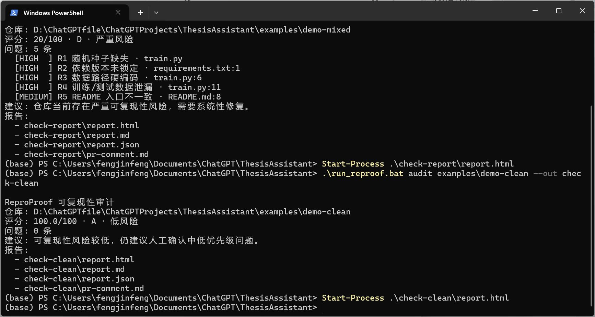
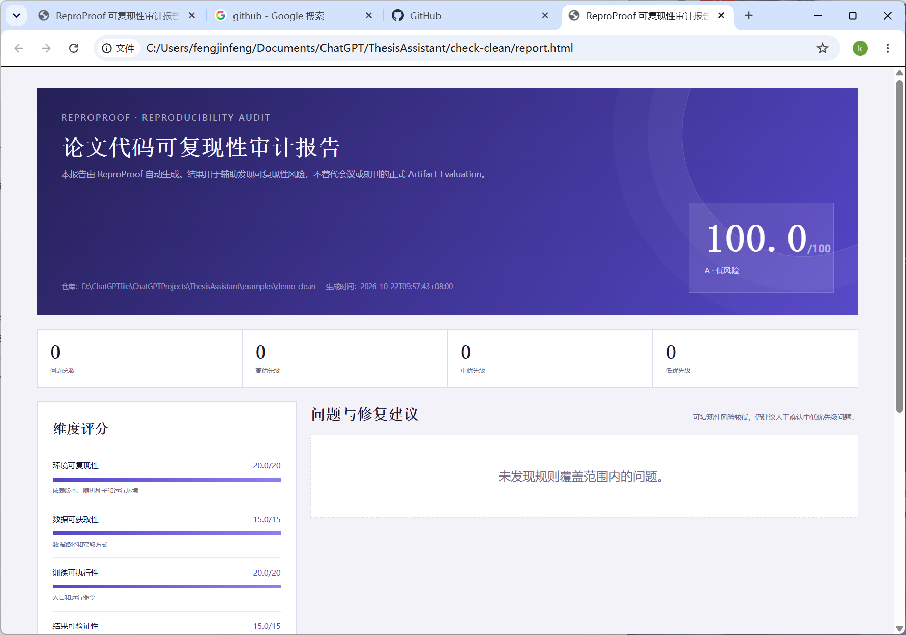

# ReproProof MVP 测试报告

> 测试日期：2026-10-22  
> 测试版本：ReproProof v0.1.0  
> 测试类型：内部受控测试，不代表真实世界通用精度

## 1. 测试环境

- Windows 11；
- Python 3.13（开发运行环境）；
- Python 3.9+ 兼容目标；
- CLI、HTML/Markdown/JSON/PR 报告；
- 独立 ZIP 包验证。

## 2. 功能测试

| 编号 | 测试项 | 结果 |
|---|---|---|
| T01 | 随机种子缺失检测 | 通过 |
| T02 | 依赖版本未锁定检测 | 通过 |
| T03 | 数据路径硬编码检测 | 通过 |
| T04 | 训练/测试数据泄漏检测 | 通过 |
| T05 | README 入口一致性检测 | 通过 |
| T06 | 论文-代码数据集不一致检测 | 通过 |
| T07 | 论文-代码指标不一致检测 | 通过 |
| T08 | HTML 报告生成 | 通过 |
| T09 | Markdown 报告生成 | 通过 |
| T10 | JSON 报告生成 | 通过 |
| T11 | PR 评论生成 | 通过 |
| T12 | CLI `--fail-on high` 退出码 | 通过 |
| T13 | 干净仓库无误报 | 通过 |
| T14 | 打包后独立运行 | 通过 |
| T15 | 离线 PDF 解析 | 通过 |

## 3. 受控测试集

| 仓库 | 注入问题 | 检测规则 | 结果 |
|---|---|---|---|
| demo-basic | 种子、依赖、路径 | R1/R2/R3 | 全部命中 |
| demo-leak | 预处理早于数据划分 | R4 | 命中 |
| demo-readme | README 命令不存在 | R5 | 命中 |
| demo-paper | 数据集和指标不一致 | R6 | 2 条命中 |
| demo-mixed | 综合缺陷 | R1/R2/R3/R4/R5 | 全部命中 |
| demo-clean | 无缺陷 | 无 | 0 误报 |

## 4. 汇总结果

- 仓库数量：6；
- 期望规则组合：11；
- 实际命中：11；
- 识别问题：12 条；
- 干净仓库误报：0；
- 自动化测试：11 个通过；
- CLI/GitHub Action 失败阈值：可配置。

## 5. 示例评分

| 仓库 | 评分 | 等级 |
|---|---:|---|
| demo-basic | 46 | D · 严重风险 |
| demo-leak | 82 | B · 需关注 |
| demo-readme | 92 | A · 低风险 |
| demo-paper | 64 | C · 高风险 |
| demo-mixed | 20 | D · 严重风险 |
| demo-clean | 100 | A · 低风险 |

## 6. 说明

该测试是人为注入缺陷的受控测试，主要验证规则链路和工程可运行性，不能直接外推为真实论文仓库上的准确率。正式参赛前应使用 3-5 个公开 ML 仓库进行补充测试，并记录误报和人工确认结果。

## 7. 当前边界

- 只支持 Python；
- 数据泄漏检测覆盖常见模式；
- 论文-代码一致性只覆盖有限字段；
- 不执行完整训练；
- 默认只做静态分析；
- 报告需人工复核。

## 8. 现场验证截图

缺陷仓库 CLI 结果：

干净仓库 HTML 报告：

## 9. 真实公开仓库测试

| 仓库 | 评分 | 问题数 | 结果 |
|---|---:|---:|---|
| kuangliu/pytorch-cifar | 64 | 2 | R1/R2 命中 |
| lucidrains/vit-pytorch | 82 | 1 | R1 命中 |
| hunkim/DeepLearningZeroToAll | 82 | 1 | R2 命中 |

真实仓库测试共检出 4 条风险，人工复核未发现明显误报。详细记录见 `reproof-real-repo-test.md`。
